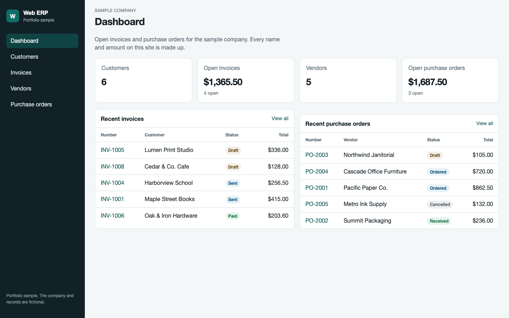
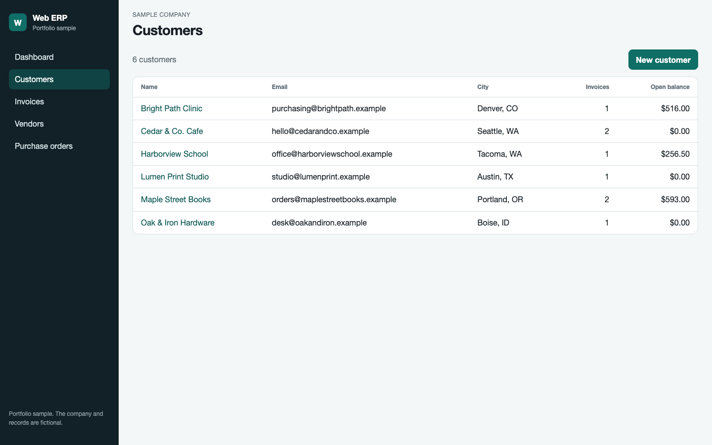
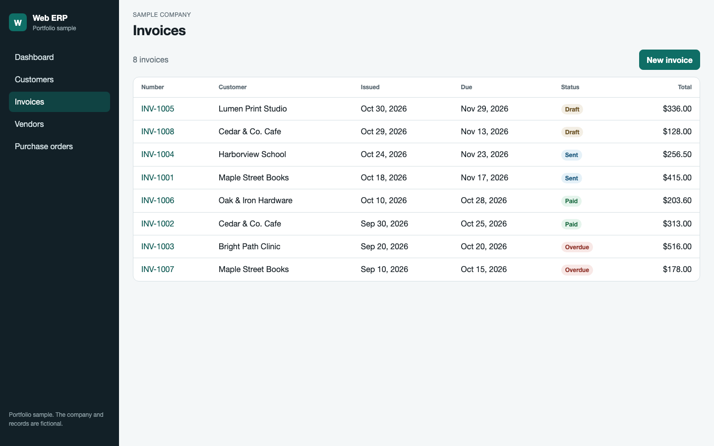
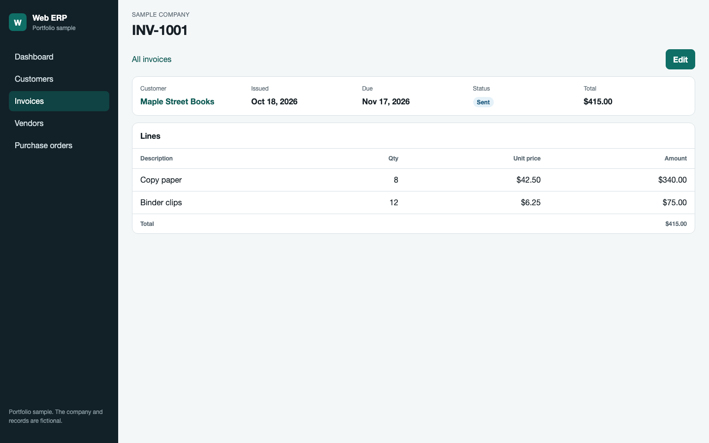
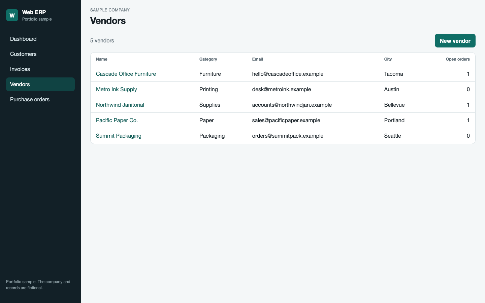
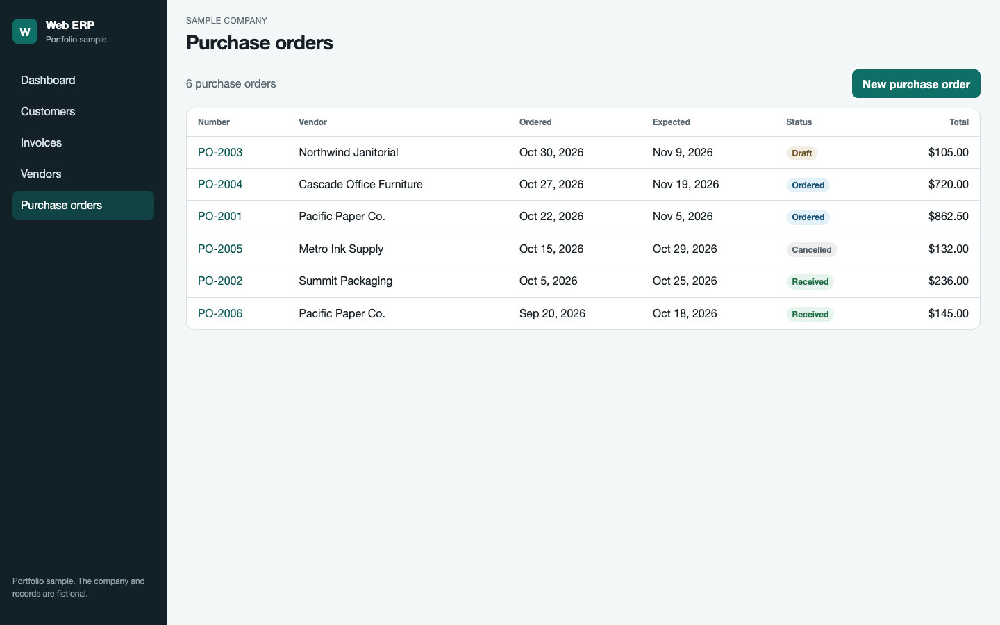

# Web ERP

Web ERP is a small web ERP for a personal portfolio. It is a recreation of an academic ERP project from 2023. The original source was not on this machine, so this app was built again around the same work: a dashboard, customers, invoices, vendors, and purchase orders.

This folder is separate from Mynbook and from NAZ HS. The records in the app are fictional sample data.

## Stack

- ASP.NET Core MVC on .NET 10
- C#
- Entity Framework Core
- Microsoft SQL Server 2022
- HTML, CSS, and JavaScript

## What you can do

- Read dashboard totals for open invoices and open purchase orders
- Browse, add, and edit customers
- Browse, add, and edit invoices, including line items
- Browse, add, and edit vendors
- Browse, add, and edit purchase orders, including line items

There is no login. The first time the site starts, it creates the `WebErp` database and loads the sample rows. Later starts leave that data as it is.

## Screenshots

Dashboard



Customers



Invoices



Invoice detail



Vendors



Purchase orders



## Run it locally

You need the .NET 10 SDK and Docker. On this Mac, Docker runs through Colima, and the Compose command is `docker-compose`.

SQL Server’s container is built for x64. On Apple Silicon, Colima’s normal virtual machine runs that container with QEMU, and SQL Server exits immediately. Use a Colima profile with Rosetta instead. That profile is already created here under the name `weberp`.

### 1. Start SQL Server

From this folder:

```bash
docker context use colima-weberp
docker-compose up -d
```

Give it a short time, then check the log:

```bash
docker logs weberp-sql
```

Wait until you see `SQL Server is now ready for client connections`.

The demo login is `sa` / `WebErp_Local1!`. That password is only for this local database.

On a new Apple Silicon Mac with Colima, create the profile once:

```bash
softwareupdate --install-rosetta --agree-to-license
colima start --profile weberp --cpu 2 --memory 4 --disk 20 --vm-type vz --vz-rosetta
docker context use colima-weberp
docker-compose up -d
```

Docker Desktop works too when Rosetta emulation for x64 containers is turned on. From this folder, `docker-compose up -d` is enough.

### 2. Start the site

```bash
cd src/WebErp
dotnet run
```

Open [http://localhost:5088](http://localhost:5088).

The connection string is in `src/WebErp/appsettings.json`. It points at `localhost,1433`.

## Sample data

Sample rows are inserted only when the customer table is empty. Stopping and starting the site does not add them again.

## GitHub

Nothing in this folder has been committed or pushed. When you want it on GitHub, commit it from this folder and push it yourself.
